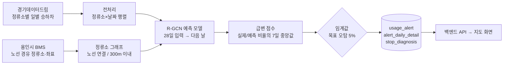

# 이음 · AI

> 용인시 버스 노선 진단 서비스 **이음**의 AI 파트예요.
> 정류소 1,628곳의 이용량을 **관계형 그래프 신경망(R-GCN)**으로 예측해서, 평소와 다르게 이용량이 급변한 정류소를 시청과 버스회사에 알려줘요.

<p>


</p>

## 한눈에 보기

| | |
|---|---|
| **문제** | 시청 담당자는 수천 개 정류소의 이용 변화를 일일이 볼 수 없어요. 노선이 바뀌거나 공사가 있어서 이용이 급감한 정류소를 늦게 알게 돼요. |
| **접근** | 정류소별 "평소 이용량"을 예측하고, 실제 이용량이 예측에서 크게 벗어나면 알림을 보내요. 예측이 정확할수록 진짜 이상만 남아요. |
| **핵심 아이디어** | 정류소는 독립적이지 않아요. **같은 노선으로 이어진 이웃**과 **걸어갈 수 있는 거리의 이웃**을 서로 다른 관계로 보는 그래프 모델을 썼어요. |
| **결과** | 같은 오탐률 2%에서 급변 탐지율이 **7.6% → 63.8%**로 올랐어요. 기존 "같은 요일 평소값" 방식보다 **8.4배** 많이 잡아요. 7일 예측 오차(WAPE)는 9.40% → 7.73%로 줄었어요. |
| **서비스 연결** | 매달 배치로 결과를 백엔드 DB 테이블 형식(CSV)으로 내보내요. 노선 중단 "만약에" 시뮬레이션 함수도 제공해요. |

## 전체 흐름



## 데이터

| 데이터 | 출처 | 규모 |
|---|---|---|
| 정류소별 일별 승하차 | 경기데이터드림 「경기도 정류소 별 승하차 인원 집계」 | 2024-10-18 ~ 2026-08-31 · 정류소 2,781곳 · 166만 행 |
| 노선 경유 정류소 | 용인시 버스노선 정보 (BMS) | 노선 367개 · 23,450행 |
| 정류소 위치 | 용인시 버스정류소 현황 | 2,607곳 |

- **수집**: 원본은 월별 zip → tar → 일별 gz(EUC-KR) 형태예요. 2년치를 받아서 용인시 정류소만 걸러 냈어요.
- **정제**:
  - 2024-09-01 ~ 10-17은 일부 운수사 데이터가 통째로 빠져서(정류소 약 30% 누락) 제외했어요.
  - 공휴일이나 폭설로 생긴 급감은 실제 현상이라 지우지 않았어요. 대신 "용인 전체 급감일" 특성으로 모델에 알려줬어요.
- **모델 대상**: 관측률 90% 이상, 하루 평균 10명 이상인 정류소 **1,628곳**이에요.

## 모델

### 문제 정의
- **입력**: 지난 28일의 정류소별 이용량(승차 + 하차, log1p)과 달력 특성(요일, 용인 전체 급감일)
- **출력**: 다음 7일 이용량
- **알림 기준선**: 1일 앞 예측

### 그래프
- **노드**: 정류소 1,628개
- **엣지 두 종류** (양방향 기준 9,388개)
  - **노선 연결** (3,104개): 같은 노선에서 바로 앞뒤 정류소예요. 승객이 실제로 이동하는 관계예요.
  - **거리 연결** (6,284개): 300m 이내 정류소예요. 걸어서 갈아탈 수 있는 관계예요.

### 구조 (파라미터 3.9만 개)
```
정류소별 시계열 ─► GRU 인코더 (+ 정류소 임베딩, 달력)
                    │
                    ▼
        관계형 그래프 합성곱 × 2층 (잔차 연결)
        h ← h + ReLU( W_route·Â_route·h  +  W_near·Â_near·h )
                    │
                    ▼
        MLP 헤드 (+ 미래 7일 달력) ─► 7일 예측
```
- 연결 종류마다 **가중치를 따로** 배워요(R-GCN). "노선으로 이어진 이웃"과 "가까운 이웃"이 주는 정보가 다르기 때문이에요.
- 비교 실험(GRU, GCN, R-GCN)은 그래프 부분만 바꾸고 나머지 구조는 같게 둬서, **그래프의 효과만** 비교되게 했어요.

## 평가

기간 나누기: 학습 ~2026-03-02 / 검증 ~06-01 / 테스트 06-02 ~ 08-31 (91일). 신경망은 시드 3개로 평균을 냈어요.

### 1) 7일 이용량 예측

| 모델 | WAPE ↓ | MAE (명/일) ↓ |
|---|---|---|
| 같은 요일 평소값 (기존 방식) | 9.40% | 23.9 |
| LightGBM | 8.35% | 21.2 |
| GRU (그래프 없음) | 7.86% ± 0.10 | 19.95 |
| GCN (연결 종류 구분 없음) | 7.87% ± 0.21 | 19.98 |
| **R-GCN (연결 종류 구분)** | **7.73% ± 0.06** | **19.65** |

- 그래프를 **그냥 붙이면(GCN) 효과가 없었고**, 연결 종류를 나눴을 때만 좋아졌어요.
- R-GCN은 시드 3개 모두에서 GRU보다 좋았어요.

### 2) 급변 탐지

실제 급변에는 정답 라벨이 없어서 **가짜 급변을 심어서** 평가했어요.

- **방법**: 테스트 기간 정류소 150곳에 10일간 이용량 ×0.4(급감) 또는 ×1.8(급증)을 심고, 3회 반복했어요.
- **비교 기준**: 모델마다 임계값이 다르면 공정하지 않아서, **같은 오탐률에서의 탐지율**로 비교했어요.

| 기준선 | 오탐 1% | 오탐 2% | 오탐 5% |
|---|---|---|---|
| 같은 요일 평소값 | 0.0% | 7.6% | 83.3% |
| GRU | 18.6% | 44.1% | 84.4% |
| GCN | 24.7% | 52.1% | 89.6% |
| **R-GCN** | **35.1%** | **63.8%** | **93.9%** |

- 오탐률이 낮을수록 차이가 커요. 담당자가 "알림이 뜨면 믿을 수 있는" 구간에서 가장 유리해요.
- 급감은 거의 다 잡아요(오탐 5%에서 99.7%). 급증은 상대적으로 어려워요(88%).

## 내가 내린 판단들

| 고민 | 선택과 이유 |
|---|---|
| 고정 임계값(0.6배 / 1.6배) vs 오탐률 기준 | 고정 임계값은 모델마다 오탐률이 달라서 비교도 운영도 어려웠어요. **목표 오탐률 5%로 맞춘 임계값**(0.72배 / 1.39배)을 써요. |
| 기준선을 7일 전 예측 vs 1일 전 예측 | 7일 전 예측이 급변에 덜 끌려갈 거라 예상했는데, 실험해 보니 오히려 나빴어요. **1일 앞 예측**을 써요. |
| 실시간 서빙 vs 배치 | 데이터가 월 단위로 공개돼서 실시간 추론이 필요 없어요. **월 1회 배치**로 결과를 테이블에 넣고, 백엔드는 읽기만 해요. 서버에 torch를 올릴 필요가 없어요. |
| 공휴일 처리 | 공휴일을 지우지 않고 "용인 전체 급감일" 특성으로 넣었어요. 알림에서는 EXPECTED(예상된 변화)로 따로 분류해요. |
| 운영 모델 검증 | 데모 결과(6~8월)는 **3월까지만 학습한 모델**로 만들었어요. 학습에 쓰지 않은 기간이라 운영과 같은 조건으로 확인할 수 있어요. |

## 서비스 연결

- **월간 배치** `scripts/run_batch.py`
  - 결과를 백엔드 테이블 형식 CSV로 만들어요: `analysis_run`, `stop_diagnosis`, `usage_alert`, `alert_daily_detail`
  - 실행 시간은 약 1분이에요.
- **시뮬레이션** `ieum_ai/simulation.py`의 `simulate()`
  - 노선을 운행 중단했을 때 정류소별 위험도(신호등) 변화, 고립 정류소, 영향 승객을 계산해요.
  - 순수 파이썬이라 Django에서 바로 import해요. 요청 하나에 1ms 미만이에요.
- **테이블 충돌 방지**
  - AI는 분석할 때마다 새 `analysis_run`을 만들고, 행을 **추가만** 해요. 다 넣은 뒤 `COMPLETED`로 바꿔요.
  - 백엔드와의 연동 방법은 [HANDOVER.md](HANDOVER.md)에 정리했어요.

## 한계와 다음 단계
- **실제 사례 검증이 필요해요.** 정답 라벨이 없어서 가짜 급변으로 평가했어요. 시청 검토 결과(`alert_review`)가 쌓이면 실제 정밀도를 잴 수 있어요.
- **마을버스 노선이 빠져 있어요.** 그래서 그래프에서 연결이 없는 정류소가 156곳이에요. 노선이 들어오면 다시 학습하고, 위험도(신호등)도 계산할 거예요.
- **방학 분류를 추가할 거예요.** 학사일정 데이터가 들어오면 방학으로 생긴 변화도 EXPECTED로 분류할 거예요.

## 폴더 구조
```
ieum_ai/
  forecast.py     예측 모델 (평소값, LightGBM, GRU, GCN, R-GCN), 학습·평가
  graph.py        정류소 그래프 (노선 연결 + 300m 거리)
  dataset.py      일별 이용량 행렬, 달력 특성
  pipeline.py     운영용: 모델 불러오기, 새 데이터 정렬, 급변 점수
  simulation.py   노선 중단 시뮬레이션 simulate()
scripts/
  run_experiments.py       GRU / GCN / R-GCN × 시드 3개 비교
  eval_injection_curve.py  가짜 급변 주입 평가 (같은 오탐률 비교)
  train_final.py           서비스용 모델 학습 → models/rgcn_v1.pt
  calibrate_threshold.py   목표 오탐률 임계값 → models/threshold.json
  run_batch.py             월간 배치 → 백엔드 테이블 CSV
results/RESULTS.md         실험 결과 정리
out/demo_2026-06_08/       데모용 분석 결과
```

## 실행
```bash
pip install -r requirements.txt
python -m pytest tests                                   # 시뮬레이션 테스트
python scripts/run_experiments.py                        # 모델 비교 (CPU 약 2시간)
python scripts/train_final.py                            # 서비스용 모델 학습
python scripts/run_batch.py --from 2026-06-01 --to 2026-08-31 --out out/2026-08
```
